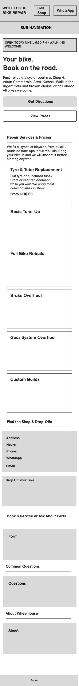

# Wheelhouse Bike Repair - Website Rebuild

This repository contains the mobile-first, semantic rebuild of the Wheelhouse Bike Repair website, including the initial layout sketch, technical diagnosis of the legacy site, and post-rebuild audit.

---

## 1. Page Structure Sketch & Rationale (Understand)

### Three Things a Customer Must Learn Within Five Seconds

| Priority | What the customer must learn                                 | Words from the brief that justify it                                                                                                                                                        | Where it sits in the layout                                                                                                             |
| :------- | :----------------------------------------------------------- | :------------------------------------------------------------------------------------------------------------------------------------------------------------------------------------------ | :-------------------------------------------------------------------------------------------------------------------------------------- |
| 1        | Can they fix my urgent bike problem today?                   | "Most customers find the shop when they need a repair urgently, whether that is a flat, a broken chain, or a bike that has not been serviced in years" and "They need it fixed today."      | Top hero status banner, main heading, and the first service cards right below the fold.                                                 |
| 2        | Where is the shop located and how do I reach them right now? | "Wheelhouse is a small bike repair and tune-up shop at Adum Commercial Area in Kumasi" and "they search on their phone for a nearby workshop".                                              | Sticky top bar with Call and WhatsApp buttons, plus the Adum address and Get Directions button in the hero.                             |
| 3        | Is this a professional, reliable workshop with fair prices?  | "They look at two or three shops on their phone and pick the one that looks like it knows what it is doing. I do good work here." and "He is more concerned with people trusting the shop". | Transparent starting prices (From GH₵ 60) and clear walk-in inspection rules visible immediately without scrolling through filler text. |

### Initial Layout Sketch

### Why the Page is Ordered This Way

Most of Kwame's customers are not browsing for fun. They are looking at their phones on the roadside with a flat tyre, broken chain, or neglected bike that needs fixing today. When they compare two or three shops in Kumasi, the top of the page has to answer their core questions within five seconds:

1. **Can I reach them or find them right now?** The top bar keeps one-tap **Call Shop** and **WhatsApp** buttons visible at all times, while the hero banner immediately confirms the shop's exact location (**Shop 4, Adum Commercial Area, Kumasi**), opening hours (**8:00 AM to 5:30 PM**), and a direct **Get Directions** button.
2. **Can they fix my problem today, and how much will it cost?** Immediately below the hero, **Repair Services & Pricing** puts urgent jobs (Tyre & Tube Replacement from GH₵ 60 and Basic Tune-Ups from GH₵ 80) first, followed by full rebuilds and overhauls. Showing clear starting prices builds immediate trust.
3. **How do drop-offs work?** Before asking the user to fill out a form or read FAQs, the **Find the Shop & Drop-Offs** section sits right below the services so walk-in customers can see the address, contact links, and the GH₵ 10/day overnight storage policy. Secondary details (the booking form, FAQs, and Kwame's 2019 backstory) are placed further down the page for visitors who have time to read more.

---

## 2. Diagnosis of the Current Wheelhouse Website (Analyse)

Right now, the Wheelhouse website is getting in its own way. It was designed for someone sitting comfortably at a desktop computer, when in reality, Kwame's actual customer is stranded on the side of the road in Kumasi staring at their phone.

| Symptom                                                                                           | Root cause                                                                                                                                           | Evidence                                                                                                                                                                                                                                       | Who is affected                                                                     | Why it matters to the business                                                                                                                        |
| :------------------------------------------------------------------------------------------------ | :--------------------------------------------------------------------------------------------------------------------------------------------------- | :--------------------------------------------------------------------------------------------------------------------------------------------------------------------------------------------------------------------------------------------- | :---------------------------------------------------------------------------------- | :---------------------------------------------------------------------------------------------------------------------------------------------------- |
| Desktop layout shrinks to unreadable tiny text and scrolls sideways on phones.                    | Missing viewport meta tag, fixed 960px container widths, and fixed-width floated columns.                                                            | `<head>` has no `<meta name="viewport">`. `styles.css` sets `width: 960px` on `#topnav`, `#headerbanner`, `#pagewrap`, `#pagefooter` and `float: left; width: 280px` on `.service-box`. Inline styles force `width: 380px` and `360px` floats. | Mobile customers searching in a hurry on the roadside.                              | Stranded cyclists will not pinch, zoom, and pan across a broken page in the sun. They bounce immediately to the competitor down the road.             |
| Customers cannot tap to call or find the shop address without scrolling to the bottom.            | Inverted DOM order, dead anchor links, and plain text contact details instead of protocol links.                                                     | Location and hours sit at the bottom of `#pagewrap` below 6 services, 4 FAQs, and About text. `#topnav` uses `href="#"`. Phone (`0322 000 000`) and WhatsApp (`0244 000 001`) have no `tel:` or `wa.me` links.                                 | Urgent mobile users with dirty hands trying to call or find the shop.               | Forcing an urgent customer to scroll, highlight, copy, and paste a phone number creates friction right when they are ready to pay for a repair.       |
| Poor readability in bright sunlight, broken keyboard navigation, and weak local search structure. | Non-semantic `
` markup, skipped heading levels, ` ` layout spacing, and 11px to 12px low-contrast fonts.                                     | Layout uses generic `
` blocks instead of `<header>`, `<nav>`, `<main>`, `<section>`, `<address>`, `<footer>`. Header skips from `<h1>` to `<h3>`. FAQs use static `
`. Text uses `font-size: 12px; color: #555`.  | Screen reader and keyboard users, outdoor mobile users, and search engine crawlers. | Tiny 12px grey text washes out in outdoor glare, and lack of semantic HTML landmarks hurts local Kumasi search rankings for bike repair.              |
| Service requests fail to submit and the bottom contact form renders outside the page layout.      | Forms use dead button inputs without labels or validation, inline rainbow styles override CSS, and `#contact-section` is placed outside `#pagewrap`. | Both forms use `<input type="button">` instead of `<button type="submit">` and lack `<label>` and `required` attributes. `
` sits outside `#pagewrap` with no rules in `styles.css`.                                  | Customers trying to book a drop-off or check if a spare part is in stock.           | Unanswered form submissions mean lost leads for Kwame, while the unaligned bottom form and random inline border colors make the shop look unreliable. |

### Breakdown of Root Causes and Business Cost

1. **A Desktop-Only Build for a Mobile-First World:** Without a viewport meta tag and with rigid `960px` widths and fixed pixel floats (`280px`, `380px`, `360px`), mobile browsers cram the wide desktop canvas onto a small phone screen. Inline float styles in the "Find Us" section also prevent CSS media queries from stacking columns cleanly.
2. **Buried Contact Info, Dead Nav Links & Unclickable Numbers:** Placing the shop location and phone numbers at the bottom of the DOM forces hurried users to scroll past FAQs and company history. Because the `#topnav` links point to `href="#"` and the numbers lack `tel:` and `https://wa.me/` wrappers, users cannot jump to contact details or tap to call.
3. **Generic "Div" Markup That Hurts Accessibility and Local Search:** Using `
` tags for every landmark, skipping `<h2>` in the banner, using `<b>` and `  ` inside `.service-box`, and building FAQs with plain `
` tags strips away document structure for assistive tech and search bots. Combined with `12px` text in `#555` grey, outdoor legibility suffers.
4. **Broken Forms, Inline Style Overrides & an Unstyled Footer Section:** Relying on `<input type="button">` without `<label>` bindings, `required` checks, or `type="tel"` leaves customers with two broken forms that never reach Kwame. Placing `#contact-section` outside `#pagewrap` with zero CSS rules leaves the bottom of the site visually broken, while six different inline `border-top` hex colors clutter the service list.

---

## 3. Audit of the Rebuilt Page (Evaluate)

When rebuilding the Wheelhouse site, I decided not to throw away the visual identity Kwame's cousin started with. Instead, I kept the core workshop colors (`#1a1a1a` charcoal, `#2c3e50` navy, `#f1c40f` yellow, and `#c0392b` red) and Tahoma font stack, while stripping out the parts that made the site look broken and untrustworthy on mobile phones.

### Semantic HTML & Page Order

- **What I changed:** The original site used generic `
` blocks for everything (`#topnav`, `#headerbanner`, `#pagewrap`, `#pagefooter`) and used `  ` tags to create spacing inside the service cards. I replaced these with proper semantic landmarks (`<header>`, `<nav>`, `<main>`, `<section>`, `<article>`, `<address>`, and `<footer>`). For the FAQs, I replaced the static `
` containers with native HTML `
` and `
` tags so they open and close without needing heavy scripts.
- **Why I prioritised this:** Moving the shop's location ("Shop 4, Adum Commercial Area") and operating hours into the hero banner and pulling the "Find the Shop" section up right below the services directly answers the brief. When someone has a flat tyre or broken chain, they don't want to read Kwame's 2019 founding story before finding out where the shop is located.

### Baseline Accessibility

- **What I changed:**
  1. Added the missing `<meta name="viewport" content="width=device-width, initial-scale=1.0">` tag and removed all hardcoded `width: 960px` and `float: left` rules so the layout stacks cleanly in a single column on small phone screens.
  2. Increased the base body font size from `12px` to `16px` (`1rem`), darkened the muted grey text from `#555` to `#4a4a4a`, and slightly deepened the accent red to `#c0392b` so white button text passes contrast guidelines.
  3. Merged the two separate, broken forms at the bottom of the old page ("Book a Service" and "Send Us a Message") into one working `<form>`. I replaced the dead `<input type="button">` with a real `<button type="submit">`, added explicit `<label for="...">` tags for every input, and set `type="tel"` on the phone field.
- **Why I prioritised this:** Customers looking up Wheelhouse are often outside on the roadside in bright Kumasi sunlight. Tiny 12px text and low-contrast placeholders are unreadable on a phone screen with glare. Setting `type="tel"` also brings up the number pad immediately on mobile phones, making it faster to leave a contact number.

### Visual Consistency

- **What I changed:** In the original HTML, every `.service-box` had an inline `border-top` in a different random color (red, blue, orange, green, purple, and teal). I moved all styling into `styles.css` and used only two top-border colors: red (`#c0392b`) for the three most urgent repairs (Tyres/Tubes, Basic Tune-Up, Full Rebuild) to draw the eye first, and workshop navy (`#2c3e50`) for the remaining three specialist overhauls.
- **Why I prioritised this:** Kwame mentioned he doesn't want the site to look "trendy for its own sake", he just wants people to see that he runs a serious, reliable workshop. Removing the rainbow borders and aligning the cards into a clean CSS Grid makes the business look organized and dependable.

---

## 4. Additional Improvement: One-Tap Call/WhatsApp Header & Live Open Status (Create)

### What I Added

1. **Sticky One-Tap Contact Bar:** In the original site, the phone number (`0322 000 000`) and WhatsApp number (`0244 000 001`) were plain text at the bottom of the page. I placed both numbers right at the top of the sticky header as clickable buttons using `tel:0322000000` and `https://wa.me/233244000001`.
2. **Real-Time Shop Status Banner (`#shop-status`):** At the top of the hero banner, I added a small script that checks the visitor's current day and time against Wheelhouse's opening hours (Mon to Sat, 8:00 AM to 5:30 PM). During working hours, it highlights in green (`OPEN TODAY UNTIL 5:30 PM • WALK-INS WELCOME`). Outside those hours or on Sundays, it updates to `CURRENTLY CLOSED • OPENS MON-SAT AT 8:00 AM`. If JavaScript fails to load, the HTML defaults to showing the standard opening hours.

### Why It Matters for Wheelhouse

When a rider's bike breaks down in Adum, they compare two or three shops on their phone and want an answer immediately. Having to highlight, copy, and paste a phone number from the bottom of a webpage is frustrating, especially if their hands are dirty from checking a broken chain. Putting one-tap Call and WhatsApp buttons in a sticky bar means a customer can call Kwame or send him a WhatsApp photo of their broken bike from anywhere on the page in one second. Paired with the live open/closed banner, customers immediately know they won't waste a trip walking their bike over to the shop.
