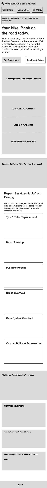

# Wheelhouse Bike Repair - Website Rebuild & Accessibility Upgrade

This repository contains the mobile-first, WCAG 2.2 Level AA rebuild of the Wheelhouse Bike Repair website in Adum, Kumasi, including the mobile layout wireframe, root-cause diagnosis of the legacy site, design system documentation, and EE02 accessibility audit artefacts.

---

## 1. Page Structure Sketch (Understand)

### Three Things a Customer Must Learn Within Five Seconds

| Priority | What the customer must learn                                                         | Why it matters for Kwame's customers                                                                                                            | Where it sits in the layout                                                                                                                                                                                                |
| :------- | :----------------------------------------------------------------------------------- | :---------------------------------------------------------------------------------------------------------------------------------------------- | :------------------------------------------------------------------------------------------------------------------------------------------------------------------------------------------------------------------------- |
| 1        | Are they open right now, where are they in Adum, and how do I reach them in one tap? | Stranded riders search on their phones needing a repair today and will not hunt for plain-text phone numbers or buried addresses.               | Sticky top header (`Call Shop` and `WhatsApp` buttons), live GMT `#shop-status` pill, hero lead (`Shop 4, Adum Commercial Area, Kumasi`), and `Get Directions` CTA.                                                        |
| 2        | Can I trust this workshop over competitors down the road?                            | Riders compare two or three shops side by side on their phones and choose the workshop that looks established, transparent, and competent.      | Hero workshop photograph of Kwame truing a wheel, overlapping `.proof-scoreboard` (`Since 2019`, `GH₵ 60+`, `7-Day Tune`), customer reviews (`#trust`), and `Common Questions` (`#faq`) all placed above the booking form. |
| 3        | Can they fix my specific bike problem today, and what will it cost?                  | Customers with a flat tyre, broken chain, or neglected bike want upfront starting prices and clear turnaround expectations before walking over. | `Send Photo on WhatsApp` quick-check banner and `Repair Services & Upfront Pricing` (`#services`) immediately below the hero.                                                                                              |

### Mobile Layout Sketch

### Why the Page Is Ordered This Way (And Refinements Made During Build)

Customers looking up Wheelhouse are usually standing on the roadside in Kumasi on a mobile phone comparing two or three repair shops in bright sunlight:

1. **Immediate Action & Real Workshop Identity (Header + Hero):** The sticky header keeps one-tap `tel:0322000000` (`Call Shop`) and `https://wa.me/233244000001` (`WhatsApp`) buttons reachable with one thumb alongside an accessible `Menu` toggle. The hero pairs a compressed photograph of Kwame working on a bicycle wheel (`images/workshop-hero.jpg`) with a live Ghana Standard Time (`Africa/Accra`) open/closed banner and an overlapping specification scoreboard (`Since 2019`, `GH₵ 60+`, `7-Day Tune`).
2. **Roadside Triage & Upfront Pricing (`#services`):** Directly below the hero, a high-visibility WhatsApp photo-estimate banner lets unsure riders snap a picture of a punctured tyre sidewall or snapped chain to confirm part stock before walking over, followed by six scannable service cards with mechanical SVG icons and upfront starting prices (`From GH₵ 60`).
3. **Competitor-Beating Credibility Before Booking (`#trust` & `#faq`):** Rather than burying Kwame's 2019 workshop history at the bottom of the page, `Why Kumasi Riders Choose Wheelhouse` (Kwame's personal supervision and local rider reviews from Adum, KNUST, and Bantama) and `Common Questions` sit above the form so visitors have every trust question answered before deciding to visit or book.
4. **Visually Distinct Location vs. Policy Panels (`#location`) & Dual-Purpose Form (`#booking`):** `Find the Workshop & Drop-Off Rules` separates the dark asphalt shop directory (with a landmark cue and direct `Open in Google Maps` link) from the warm amber `1-2-3` walk-in policy card so the two never blend together at a glance. Finally, the consolidated form uses a `<fieldset>` mode switch so customers can either **Book a Repair Drop-Off** or **Ask a Question / Check Parts**.
5. **Typography Refinement Note:** The wireframe uses `Balsamiq Sans` to establish an approachable, human-crafted shop personality. During implementation, `Balsamiq Sans` (`700`) was retained on the brand title, all headings (`h1`–`h3`), scoreboard stats, prices, and FAQ triggers, while `Inter` (`400`–`700`) was paired for body paragraphs, labels, and buttons so dense pricing details and form inputs remain crisp in outdoor glare and at `400%` browser zoom.

---

## 2. Diagnosis of the Legacy Website (Analyse: Symptom vs. Root Cause)

| Symptom                                                                                            | Technical root cause in legacy code                                                                                                          | Evidence from legacy `index.html` & `styles.css`                                                                                                                                                              | Who is affected                                                                                                              | Cost to Kwame's business                                                                                                  |
| :------------------------------------------------------------------------------------------------- | :------------------------------------------------------------------------------------------------------------------------------------------- | :------------------------------------------------------------------------------------------------------------------------------------------------------------------------------------------------------------ | :--------------------------------------------------------------------------------------------------------------------------- | :------------------------------------------------------------------------------------------------------------------------ |
| Desktop page shrinks into tiny unreadable text or scrolls sideways on phones.                      | Missing viewport meta tag, fixed `960px` container widths, and fixed-width floated columns.                                                  | No `<meta name="viewport">` in `<head>`; hardcoded `width: 960px` on `#topnav`, `#headerbanner`, `#pagewrap`, `#pagefooter`; `float: left; width: 280px` on `.service-box` and inline `380px`/`360px` floats. | Mobile riders searching in a hurry on the roadside and low-vision users zooming to `400%`.                                   | Stranded cyclists will not pinch-zoom and pan across a broken desktop layout in the sun; they bounce to a competing shop. |
| Customers cannot tap to call or find the shop without scrolling through the whole page.            | Inverted DOM order, dead `#` navigation links, and plain-text phone numbers without `tel:` or `wa.me` URIs.                                  | Shop address and hours sat near the bottom of `#pagewrap`; `#topnav` used `href="#"` placeholders; `0322 000 000` and `0244 000 001` were unlinked text.                                                      | One-handed mobile users or riders with grease on their hands trying to call or get directions quickly.                       | Extra friction at the exact moment a customer wants to walk in or confirm part availability costs immediate walk-in jobs. |
| Washed-out text in daylight, broken keyboard/screen-reader navigation, and rainbow visual clutter. | Generic `
` soup, skipped heading levels, ` ` layout spacing, `11px–12px` pixel fonts, and six conflicting inline border colors.      | Zero semantic landmarks (`<header>`, `<nav>`, `<main>`, `<address>`, `<footer>`); `<h1>` jumped straight to `<h3>`; static `
` blocks; six inline rainbow `border-top` hex codes.     | Screen reader users, keyboard-only users, and anyone viewing the site outdoors in Kumasi sunlight.                           | Cluttered rainbow borders and tiny grey text undermine trust when compared side by side against other workshops.          |
| Both forms fail to submit requests and the second form spills outside the page container.          | Dead `<input type="button">` controls with no submit handler, missing `<label>` elements, and `#contact-section` placed outside `#pagewrap`. | Both forms used `<input type="button">` instead of `<button type="submit">`; inputs relied on disappearing placeholders with no `<label for="...">`; `#contact-section` had no layout rules.                  | Any customer trying to book a repair or ask whether a spare part is in stock, especially one-handed or assistive-tech users. | Customers lose typed details with zero confirmation and Kwame never receives online leads or part inquiries.              |

---

## 3. Design System, Accessibility & Rebuild Audit (Evaluate)

### Carbon Asphalt & Burnt Cycling Orange Palette (WCAG 2.2 AA/AAA Verified)

Instead of keeping the legacy navy/red/rainbow colors, the rebuild introduces a mechanical bike-workshop palette built for outdoor sunlight contrast:

- **Deep Tire Asphalt (`#121316` & `#1c1e24`):** Grounds the sticky header, hero, footer, and location directory card (`#ffffff` text on `#121316` = **18.5:1**, WCAG AAA).
- **Burnt Cycling Orange (`#c2410c` / hover `#9a3412`):** Single action and priority accent used consistently for primary buttons, prices, and priority `4px` top card borders (`#ffffff` on `#c2410c` = **5.18:1**, passing WCAG AA; `#9a3412` = **7.15:1**, WCAG AAA).
- **Sunlight-Safe Surfaces & Copy:** Primary copy uses `#111827` on `#ffffff` (**17.7:1**, WCAG AAA) and secondary copy uses `#374151` (**10.3:1** on white, **9.4:1** on `#f4f5f7` muted slate). Form control borders use `2px solid #4b5563` (**7.56:1** non-text contrast, exceeding the `3:1` WCAG `1.4.11` threshold).
- **High-Visibility Focus Indicators (`WCAG 2.4.7`, `1.4.11`, `2.4.11`):** Interactive elements on light surfaces show a `3px solid #c2410c` focus ring, while dark surfaces (`header`, `hero`, `location-card`, `footer`) show a `3px solid #facc15` Signal Gold ring (**12.85:1** on `#121316`). `scroll-padding-top`, `scroll-margin-top`, a `focusin` scroll guard, and a `@media (max-height: 520px), (max-width: 360px)` rule ensure the header never obscures focused elements or blocks half the viewport at `400%` zoom.

### Unified Card System, Responsive Grid & Progressive Enhancement

- **Consistent Top-Border Rule:** Every card across the site (`.card`, `.proof-scoreboard`, `.status-pill`, `.location-card`, `.rules-card`, `.booking-form`, `.faq-item`, `.form-feedback`) uses a top accent border (`3px–5px`), eliminating mixed left-vs-top border styles.
- **Fluid Reflow (`320px` to Desktop):** CSS Grid scales cleanly from `1fr` on mobile (`320px`/`375px`) to 2 columns at `640px` and 3 columns at `900px` with zero horizontal scrolling (`overflow-x: clip`) and relative `rem` sizing (`html { font-size: 100%; }`) so browser font-size preferences scale all text proportionally.
- **Accessible Mobile Navigation, Native FAQs & Dual-Mode Form:** Progressive-enhancement mobile menu (`<button aria-expanded>` + `Escape` key dismissal + auto-close on `focusout`), native `
`/`
` accordions, and a single accessible `<form>` with `<fieldset>`/`<legend>` mode selection, explicit `(required)` labels, `autocomplete="name"` and `autocomplete="tel"`, `aria-invalid` field recovery, and `aria-live="polite"` confirmation.

---

## 4. Visible Business Improvements (Create)

1. **One-Tap WhatsApp Photo Estimate Banner & Direct Google Maps Navigation:** Stranded cyclists often do not know the technical name of a bent derailleur or exact tube valve size. A dedicated callout banner right below the hero pre-fills a WhatsApp message so riders can send Kwame a quick photo to verify part stock and price before pushing their bike to Adum, paired with a direct Google Maps link and Adum Post Office landmark cue in `#location`.
2. **Timezone-Safe (`Africa/Accra`) Live Open/Closed Status With Non-Color Symbols:** Checks Ghana Standard Time (`GMT`) against data attributes (`data-open="8"`, `data-close="17.5"`, `data-days="1,2,3,4,5,6"`) and displays both text and non-color symbols (`● OPEN NOW UNTIL 5:30 PM` vs. `✕ CLOSED NOW`), falling back cleanly to static hours if JavaScript is unavailable.

---

## 5. EE02 Accessibility Artefacts

- **Peer Audit Conducted (Audit of Calvin Quashie's Site):** [`docs/ee02/audit-of-qcalvin3.md`](./docs/ee02/audit-of-qcalvin3.md) (with screenshots in [`docs/ee02/evidence/`](./docs/ee02/evidence/)).
- **Fixes & Further Accessibility Write-Up:** [`docs/ee02/write-up.md`](./docs/ee02/write-up.md).
