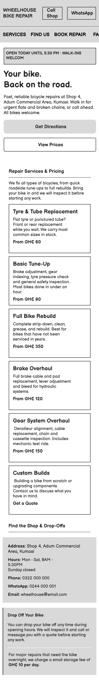

# Wheelhouse Bike Repair - Website Rebuild

This repository contains the mobile-first, semantic rebuild of the Wheelhouse Bike Repair website, including the initial layout sketch, technical diagnosis of the legacy site, and post-rebuild audit.

---

## 1. Page Structure Sketch & Rationale

### Why the Page is Ordered This Way

Most of Kwame's customers are not browsing for fun, they are looking at their phones on the roadside with a flat tyre, broken chain, or neglected bike that needs fixing today. When they compare two or three shops in Kumasi, the top of the page has to answer three questions within five seconds:

1. **Can I reach them or find them right now?** The top bar keeps one-tap **Call Shop** and **WhatsApp** buttons visible at all times, while the hero banner immediately confirms the shop's exact location (**Shop 4, Adum Commercial Area, Kumasi**), opening hours (**8:00 AM – 5:30 PM**), and a direct **Get Directions** button.
2. **Can they fix my problem today, and how much will it cost?** Immediately below the hero, **Repair Services & Pricing** puts urgent jobs (Tyre & Tube Replacement from GH₵ 60 and Basic Tune-Ups from GH₵ 80) first, followed by full rebuilds and overhauls. Showing clear starting prices builds immediate trust.
3. **How do drop-offs work?** Before asking the user to fill out a form or read FAQs, the **Find the Shop & Drop-Offs** section sits right below the services so walk-in customers can see the address, contact links, and the GH₵ 10/day overnight storage policy. Secondary details (the booking form, FAQs, and Kwame's 2019 backstory) are placed further down the page for visitors who have time to read more.

---

## 2. Diagnosis of the Current Wheelhouse Website

Right now, the Wheelhouse website is getting in its own way. It was designed for someone sitting comfortably at a desktop computer, when in reality, Kwame's actual customer is stranded on the side of the road in Kumasi staring at their phone.

The problem isn't just that the site looks dated, the underlying code makes it frustratingly difficult for people who need urgent help to actually reach out. Here is a breakdown of what is happening under the hood and how it is costing the shop business.

### 1. A Desktop-Only Build for a Mobile-First World

- **What’s happening in the code:** The HTML `<head>` is completely missing the `<meta name="viewport">` tag, which tells mobile browsers how to scale a page. On top of that, `styles.css` locks `#topnav`, `#headerbanner`, `#pagewrap`, and `#pagefooter` into a rigid `width: 960px`, and the service cards (`.service-box`) are held together using old-school, fixed-width floats (`float: left; width: 280px;`). Worse, the "Find Us" section hardcodes `float: left; width: 380px` and `width: 360px` directly inside inline HTML `style` attributes, making it impossible for CSS media queries to stack them on small screens.
- **Why it hurts the business:** When a stranded cyclist pulls up the site on their phone, their browser crams that wide 960px desktop view onto a tiny screen. The text shrinks down to an unreadable 2 or 3 pixels. Nobody dealing with a flat tyre or broken chain in the heat is going to pinch, zoom, and scroll sideways just to see if Wheelhouse can help them, they will just hit the "back" button and call the competitor down the road.

### 2. Buried Contact Info, Dead Nav Links & Unclickable Numbers

- **What’s happening in the code:** The page is laid out backwards for someone in a rush. Crucial details, like the phone number, workshop hours, and Adum location, are buried near the bottom of the DOM, beneath six service boxes, four FAQs, and the shop's 2019 backstory. Meanwhile, all five links in `#topnav` (`HOME`, `SERVICES`, `PRICING`, etc.) use dead `href="#"` attributes that don't actually scroll to those sections. Finally, the phone (`0322 000 000`) and WhatsApp (`0244 000 001`) numbers are written as plain, unlinked text instead of `tel:` and `https://wa.me/` links.
- **Why it hurts the business:** Picture a rider with grease on their hands trying to get ahold of Kwame. When they tap "CONTACT" in the menu, nothing happens. When they finally scroll to the bottom, they can't tap the number to call, they have to carefully highlight the text, copy it, switch to their phone dialer or WhatsApp, and paste it in. That is way too much friction at the exact moment a customer is trying to give Wheelhouse their business.

### 3. Generic "Div" Markup That Hurts Accessibility and Local Search

- **What’s happening in the code:** Instead of using descriptive HTML5 landmarks (`<header>`, `<nav>`, `<main>`, `<section>`, `<address>`, `<footer>`), the site is built entirely out of generic `
` blocks. It also skips heading levels (jumping from `<h1>` to `<h3>` in `#headerbanner`), uses `<b>` tags and double `  ` line breaks for layout inside the service cards, and builds the FAQ section out of plain `
` tags (`.faq-trigger`) instead of keyboard-accessible `
` and `
` elements. Body copy is also hardcoded at tiny `11px`–`13px` sizes with low-contrast `#555` grey text.
- **Why it hurts the business:** Tiny `12px` grey text is nearly impossible to read on a phone screen under bright outdoor sunlight. Furthermore, search engines rely on clean semantic headings and `<address>` tags to understand local businesses. When Googlebot crawls a wall of generic `
` and ` ` tags, it hurts Wheelhouse's local SEO visibility whenever someone in Kumasi searches for _"bike repair near me."_

### 4. Broken Forms, Inline Style Overrides & an Unstyled Footer Section

- **What’s happening in the code:**
  1. **Two competing, broken forms:** The page has two separate forms ("Book a Service" and "Send Us a Message"). Both use `<input type="button">` instead of `<button type="submit">`. Even if `js/script.js` appends items to `#booking-list` in the browser, nothing is actually sent to Kwame.
  2. **Zero form accessibility or validation:** None of the inputs have `<label>` tags (relying only on `placeholder` text that vanishes when typing), none are marked `required`, and the phone and email fields use generic `type="text"` instead of `type="tel"` and `type="email"`.
  3. **Orphaned HTML & inline styles:** The entire `
` at the bottom was accidentally placed _outside_ of `#pagewrap` and has no matching CSS rules in `styles.css`, leaving it floating unaligned against the raw grey background. Meanwhile, random rainbow border colors (`#e74c3c`, `#3498db`, `#8e44ad`, etc.) are hardcoded inline on every `.service-box`.
- **Why it hurts the business:** Anyone who fills out the message form is sending their inquiry into a black hole, Kwame never receives the lead, and the customer assumes the shop is ignoring them. Visually, the rainbow service borders and the unstyled, broken form spilling out of the bottom of the layout make the website look unfinished and amateur, which directly undermines Kwame's goal of looking like a professional, trustworthy workshop.

---

## 3. Audit of the Rebuilt Page

When rebuilding the Wheelhouse site, I decided not to throw away the visual identity Kwame's cousin started with. Instead, I kept the core workshop colors (`#1a1a1a` charcoal, `#2c3e50` navy, `#f1c40f` yellow, and `#c0392b` red) and Tahoma font stack, while stripping out the parts that made the site look broken and untrustworthy on mobile phones.

### Semantic HTML & Page Order

- **What I changed:** The original site used generic `
` blocks for everything (`#topnav`, `#headerbanner`, `#pagewrap`, `#pagefooter`) and used `  ` tags to create spacing inside the service cards. I replaced these with proper semantic landmarks (`<header>`, `<nav>`, `<main>`, `<section>`, `<article>`, `<address>`, and `<footer>`). For the FAQs, I replaced the static `
` containers with native HTML `
` and `
` tags so they open and close without needing heavy scripts.
- **Why I prioritised this:** Moving the shop's location ("Shop 4, Adum Commercial Area") and operating hours into the hero banner and pulling the "Find the Shop" section up right below the services directly answers the brief. When someone has a flat tyre or broken chain, they don't want to read Kwame's 2019 founding story before finding out where the shop is located.

### Baseline Accessibility

- **What I changed:**
  1. Added the missing `<meta name="viewport" content="width=device-width, initial-scale=1.0">` tag and removed all hardcoded `width: 960px` and `float: left` rules so the layout stacks cleanly in a single column on small phone screens.
  2. Increased the base body font size from `12px` to `16px` (`1rem`), darkened the muted grey text from `#555` to `#4a4a4a`, and slightly deepened the accent red to `#c0392b` so white button text passes contrast guidelines.
  3. Merged the two separate, broken forms at the bottom of the old page ("Book a Service" and "Send Us a Message") into one working `<form>`. I replaced the dead `<input type="button">` with a real `<button type="submit">`, added explicit `<label for="...">` tags for every input, and set `type="tel"` on the phone field.
- **Why I prioritised this:** Customers looking up Wheelhouse are often outside on the roadside in bright Kumasi sunlight. Tiny 12px text and low-contrast placeholders are unreadable on a phone screen with glare. Setting `type="tel"` also brings up the number pad immediately on mobile phones, making it faster to leave a contact number.

### Visual Consistency

- **What I changed:** In the original HTML, every `.service-box` had an inline `border-top` in a different random color (red, blue, orange, green, purple, and teal). I moved all styling into `styles.css` and used only two top-border colors: red (`#c0392b`) for the three most urgent repairs (Tyres/Tubes, Basic Tune-Up, Full Rebuild) to draw the eye first, and workshop navy (`#2c3e50`) for the remaining three specialist overhauls.
- **Why I prioritised this:** Kwame mentioned he doesn't want the site to look "trendy for its own sake", he just wants people to see that he runs a serious, reliable workshop. Removing the rainbow borders and aligning the cards into a clean CSS Grid makes the business look organized and dependable.

---

## 4. Additional Improvement: One-Tap Call/WhatsApp Header & Live Open Status

### What I Added

1. **Sticky One-Tap Contact Bar:** In the original site, the phone number (`0322 000 000`) and WhatsApp number (`0244 000 001`) were plain text at the bottom of the page. I placed both numbers right at the top of the sticky header as clickable buttons using `tel:0322000000` and `https://wa.me/233244000001`.
2. **Real-Time Shop Status Banner (`#shop-status`):** At the top of the hero banner, I added a small script that checks the visitor's current day and time against Wheelhouse's opening hours (Mon–Sat, 8:00 AM to 5:30 PM). During working hours, it highlights in green (`OPEN TODAY UNTIL 5:30 PM • WALK-INS WELCOME`). Outside those hours or on Sundays, it updates to `CURRENTLY CLOSED • OPENS MON–SAT AT 8:00 AM`. If JavaScript fails to load, the HTML defaults to showing the standard opening hours.

### Why It Matters for Wheelhouse

When a rider's bike breaks down in Adum, they compare two or three shops on their phone and want an answer immediately. Having to highlight, copy, and paste a phone number from the bottom of a webpage is frustrating, especially if their hands are dirty from checking a broken chain. Putting one-tap Call and WhatsApp buttons in a sticky bar means a customer can call Kwame or send him a WhatsApp photo of their broken bike from anywhere on the page in one second. Paired with the live open/closed banner, customers immediately know they won't waste a trip walking their bike over to the shop.
