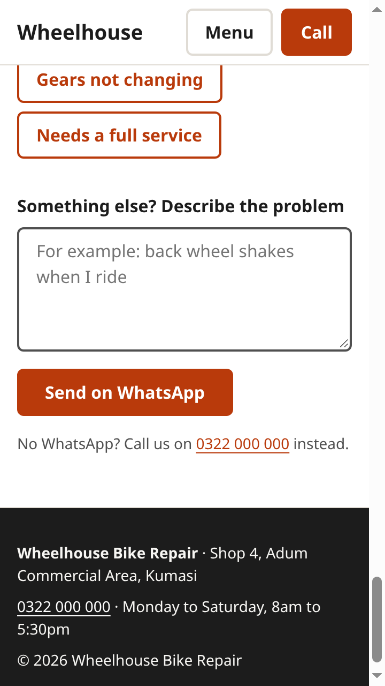
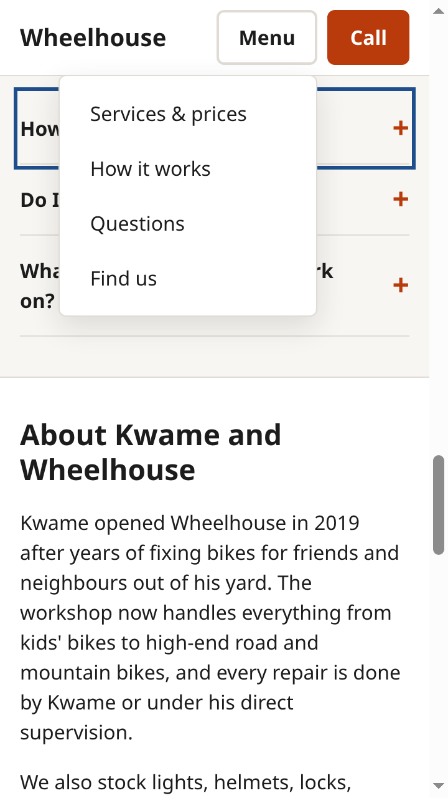
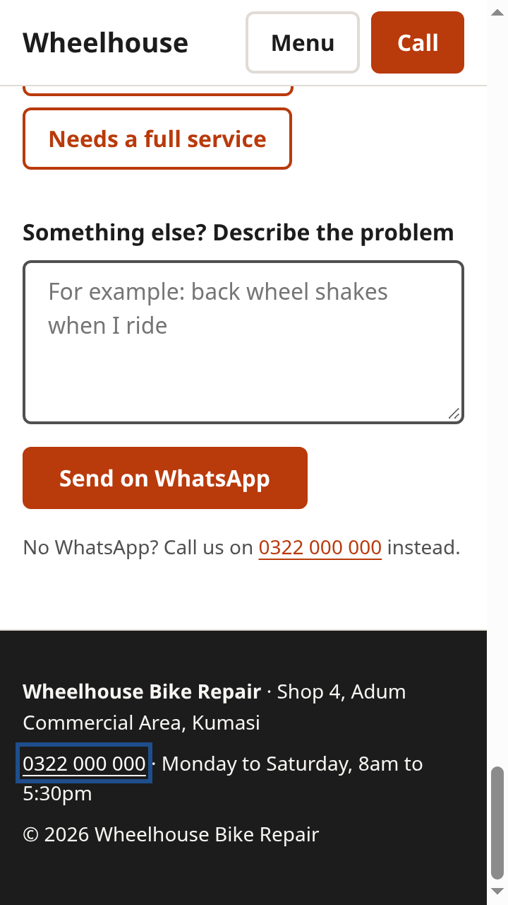
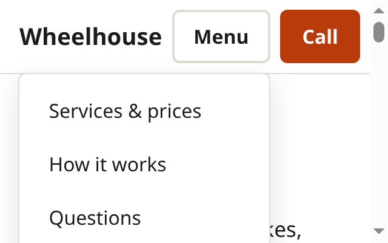

# Accessibility audit: Wheelhouse Bike Repair, Kumasi site by qcalvin3

- Site audited: [https://qcalvin3.github.io/wheelhouse-rebuild](https://qcalvin3.github.io/wheelhouse-rebuild)
- Date and time tested: 17 November 2026, 7:50pm
- Audited by: Emmanuel Ephrim
- Standard: [WCAG 2.2, level AA](https://www.w3.org/WAI/WCAG22/quickref/)

## How I tested

- Automated tools: [WAVE browser extension](https://wave.webaim.org/help), [Lighthouse extension](https://developer.chrome.com/docs/lighthouse/accessibility/scoring) in Firefox, Firefox Accessibility Inspector, and the [WebAIM Contrast Checker](https://webaim.org/resources/contrastchecker/)
- Keyboard: Firefox on Windows 11 (`Tab`, `Shift + Tab`, `Enter`, `Space`, and `Escape`); tabbed through the whole page from the skip link down to the footer and back up again
- Zoom, text size and reflow: Tested `200%` and `400%` zoom in Firefox on desktop, plus `360 x 640`, `320px` width, and `320 x 200` in Firefox Responsive Design Mode (`Ctrl + Shift + M`)
- Screen reader: NVDA on Windows 11 with Firefox; listened through the page title, headings, landmarks, FAQ questions, image description, and the WhatsApp message form
- Pages and journeys covered: Home page, covering checking opening hours and address, comparing repair prices, reading how repairs work and common questions, getting directions, and contacting Kwame by phone or WhatsApp

## Summary

The rebuilt Wheelhouse page is easy to read, well organised, and passes automated Lighthouse and WAVE checks cleanly. Text and button colours have strong contrast across the site (`4.89:1` up to `17.04:1`), `200%` zoom and `320px` phone view fit without sideways scrolling, buttons are large enough to tap comfortably, and the one-tap WhatsApp buttons are a great touch for a rider using one hand. Testing by hand in Firefox with the keyboard and zoom showed four problems worth fixing: the sticky top bar hides focused buttons when tabbing back up the page and cuts off section headings after link jumps, the `"Menu"` dropdown stays open over the page after you pick a section, the dark blue focus ring fails contrast (`2.05:1`) against the dark footer, and at `400%` zoom on a shorter laptop window the `"Menu"` dropdown cuts off `"Find us"` with no way to scroll to it.

## Findings, in priority order

### 1. Sticky top bar hides focused buttons when tabbing backwards and cuts off headings after link jumps

- Where: Home page, top header bar and all section jumps (`"Skip to main content"`, `"Wheelhouse"`, `"Menu"` links, and the one-tap WhatsApp buttons near the bottom)
- What happens: When you move back up the page with `Shift + Tab`, buttons that scroll into view at the top of the window end up tucked right behind the sticky top header, so you cannot see the button or its focus ring at all. The same sticky bar also covers the heading of whichever section you jump to from `"Menu"`, and cuts off the first line of the main headline when you use `"Skip to main content"`.
- How to reproduce:
  1. Open the live site in Firefox Responsive Design Mode (`360 x 640`), scroll to the bottom, and click inside the `"Something else? Describe the problem"` box.
  2. Press `Shift + Tab` three times (`Needs a full service` -> `Gears not changing` -> `Brakes not working well`).
  3. Look at the top of the page: focus is on `"Brakes not working well"`, which is completely hidden behind the sticky header. (You can also see headings get covered by opening `"Menu"`, clicking `"Services & prices"`, and closing `"Menu"`.)

- Evidence: Screenshot below shows `"Brakes not working well"` hidden behind the sticky top bar while focused; adding `scroll-padding-top` on the page would leave space for the header.

  

- Principle and criterion: Operable; [2.4.11 Focus Not Obscured (Minimum)](https://www.w3.org/WAI/WCAG22/Understanding/focus-not-obscured-minimum.html), AA
- Who it affects and how: Sighted keyboard users and people navigating with one hand (like Kwame's customer) cannot see which repair option they are about to press when moving back up the page, and visitors using the menu or skip link land with the section title hidden.
- Found by: Manual keyboard testing (`Shift + Tab` and `Enter`) in Firefox
- Why it ranks here: Ranked #1 because a focused button becomes completely invisible behind the header, and the same missing scroll gap affects every section link on the page.

### 2. Choosing a link in "Menu" leaves the dropdown open on top of the section you jumped to

- Where: Home page, `"Menu"` button in the top header
- What happens: After you open `"Menu"` and select any section (such as `"Questions"` or `"Services & prices"`), the page jumps down to that section, but the white menu box stays open over the middle of the screen. Pressing `Escape` does not close it, and if you keep pressing `Tab`, your focus moves onto controls hidden behind the open menu.
- How to reproduce:
  1. Open the page in Firefox (`360 x 640` phone view or desktop).
  2. Press `Tab` to reach `"Menu"`, press `Enter` to open it, then `Tab` to `"Questions"` and press `Enter`.
  3. Press `Tab` once to move onto the first question (`"How long will my repair take?"`): the open `"Menu"` box sits right on top of the focused question, and pressing `Escape` does nothing.

- Evidence: Screenshot below shows the open `"Menu"` card covering most of the focused first FAQ question after jumping to `"Questions"` (likely because the menu uses `
` with no script to close it when a link is clicked).

  

- Principle and criterion: Operable; [2.4.11 Focus Not Obscured (Minimum)](https://www.w3.org/WAI/WCAG22/Understanding/focus-not-obscured-minimum.html), AA
- Who it affects and how: Keyboard users, one-handed visitors, and phone users have a big part of the section blocked until they tap or `Shift + Tab` back up to `"Menu"` to close it by hand.
- Found by: Manual keyboard and phone navigation testing in Firefox
- Why it ranks here: Ranked #2 because everyone who uses `"Menu"` runs into this straight away, though the edges of the focused box still peek out from behind the menu.

### 3. Keyboard focus outline fails contrast (2.05:1) against the dark footer background

- Where: Home page, footer phone number (`0322 000 000`) at the very bottom of the page
- What happens: When you `Tab` past the form into the dark footer, the dark blue focus ring around the phone number blends into the dark grey background, so focus looks like it disappeared.
- How to reproduce:
  1. Scroll to the bottom of the home page in Firefox.
  2. Click inside the `"Something else? Describe the problem"` box and press `Tab` three times until focus lands on `0322 000 000` inside the dark footer.
  3. Compare that outline to the bright blue outline on `0322 000 000` in the white section just above it.

- Evidence: Using Firefox's colour picker, the `#1f4e8c` focus outline on the `#1c1c1c` footer background measures `2.05:1` in the [WebAIM Contrast Checker](https://webaim.org/resources/contrastchecker/); the minimum for a focus indicator is `3:1` (on the light sections above, `#1f4e8c` measures `7.10:1` on `#f3ece6`, `7.69:1` on `#f7f6f3`, and `8.31:1` on `#ffffff`).

  

- Principle and criterion: Operable; [2.4.7 Focus Visible](https://www.w3.org/WAI/WCAG22/Understanding/focus-visible.html), AA (and Perceivable; [1.4.11 Non-text Contrast](https://www.w3.org/WAI/WCAG22/quickref/), AA)
- Who it affects and how: Sighted keyboard users, people with low vision, and anyone outdoors in Kumasi sunlight can lose track of where their keyboard focus is at the end of the page.
- Found by: Keyboard `Tab` check and Firefox colour picker, confirmed with the [WebAIM Contrast Checker](https://webaim.org/resources/contrastchecker/)
- Why it ranks here: Ranked #3 because `2.05:1` clearly fails the `3:1` contrast minimum, though it only affects one link in the footer while every light section above passes easily.

### 4. At 400% zoom on a laptop-height window, "Menu" cuts off "Find us" and cannot be scrolled

- Where: Home page, `"Menu"` dropdown in the top header
- What happens: When the page is zoomed to `400%` on a standard laptop window (or tested at `320 x 200` in Responsive Design Mode), opening `"Menu"` pushes the last link (`"Find us"`) below the bottom edge of the window. Scrolling down with a mouse wheel or scrollbar only moves the page behind the header, so `"Find us"` never comes into view.
- How to reproduce:
  1. Open Firefox Responsive Design Mode (`Ctrl + Shift + M`) and set the screen size to `320 x 200` (matching a `1280 x 800` laptop window zoomed to `400%`).
  2. Click `"Menu"` in the header.
  3. Try scrolling down to click `"Find us"`: the background page scrolls, while `"Find us"` stays cut off off-screen.

- Evidence: Screenshot below at `320 x 200` shows `"Services & prices"`, `"How it works"`, and `"Questions"`, while `"Find us"` is cut off below the bottom of the window because the header is sticky and the menu box itself does not scroll.

  

- Principle and criterion: Perceivable; [1.4.10 Reflow](https://www.w3.org/WAI/WCAG22/quickref/), AA
- Who it affects and how: People with low vision (like Ama's customer) using `400%` browser zoom with a mouse on a laptop cannot click `"Find us"` in the menu and have to close the menu and scroll all the way down the page instead.
- Found by: Manual `400%` zoom / `320 x 200` reflow test in Firefox Responsive Design Mode
- Why it ranks here: Ranked #4 because keyboard users can still reach `"Find us"` with `Tab`, and visitors can still scroll down the page itself to find the shop's address.

## What works well

- **Colour contrast on text, prices, buttons, and form border**: Checked with WAVE, Firefox's colour picker, and the [WebAIM Contrast Checker](https://webaim.org/resources/contrastchecker/), every text and control pair passes [1.4.3 Contrast (Minimum)](https://www.w3.org/WAI/WCAG22/Understanding/contrast-minimum.html) (`4.5:1`) and [1.4.11 Non-text Contrast](https://www.w3.org/WAI/WCAG22/quickref/) (`3:1`): dark text `#1c1c1c` measures `17.04:1` on white cards (`#ffffff`), `15.77:1` on the main cream background (`#f7f6f3`), and `14.57:1` on the warm trust band (`#f3ece6`); muted grey text `#505050` measures `8.06:1` on `#ffffff` and `7.46:1` on `#f7f6f3`; orange prices, links, and buttons `#b93a0b` measure `5.72:1` on `#ffffff` and `5.29:1` on `#f7f6f3` (with tick marks on `#f3ece6` at `4.89:1` and white button text `#ffffff` on `#b93a0b` at `5.72:1`); light footer text `#f7f6f3` on `#1c1c1c` measures `15.77:1`; and the `#505050` border around the WhatsApp text box measures `8.06:1` on `#ffffff`.
- **200% zoom and 320px phone reflow**: Zooming Firefox to `200%` on desktop and testing at `320px` and `360px` wide in Responsive Design Mode showed everything stacking cleanly into one column with no sideways scrolling or clipped text ([1.4.4 Resize Text and 1.4.10 Reflow](https://www.w3.org/WAI/WCAG22/quickref/)).
- **Large tap targets and one-tap WhatsApp links**: Call buttons, `"Menu"`, FAQ rows, and the five pre-filled WhatsApp problem buttons are all tall enough (`44px`+) to tap easily with one thumb ([2.5.8 Target Size (Minimum)](https://www.w3.org/WAI/WCAG22/Understanding/target-size-minimum.html)), and the pre-written WhatsApp links save someone using one hand from typing out their bike issue.
- **Headings, landmarks, image alt text, and form label**: Checked with NVDA and WAVE Structure view, the page has a clear `<title>`, English page language, proper `<header>`, `<nav>`, `<main>`, and `<footer>` landmarks, headings in logical order (`h1` to `h3` with no skipped levels), honest `alt` text on the workshop placeholder image, and a visible label tied to the required WhatsApp message box ([1.3.1 Info and Relationships](https://www.w3.org/WAI/WCAG22/Understanding/info-and-relationships) and [3.3.2 Labels or Instructions](https://www.w3.org/WAI/WCAG22/Understanding/labels-or-instructions.html)).

## Not tested, and limits of this audit

- **Phone screen readers and voice control**: Tested with NVDA and Firefox on Windows 11; did not test VoiceOver on iPhone/Mac, or voice-control tools.
- **WhatsApp and Google Maps after clicking through**: Checked that the phone, email, WhatsApp, and Google Maps links point to the right places, but did not audit those external apps themselves.
